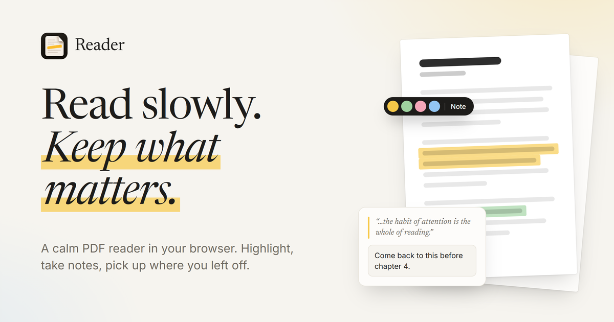

# Reader

A calm, minimal PDF reader that runs entirely in your browser. Highlight passages, keep as many notes as you like, and pick up exactly where you left off.

Your files never leave your device. PDFs, highlights and notes are stored locally in the browser (IndexedDB). There is no account, no server and no upload.

## Features

- **Fast reading.** Pages render near the viewport first, sharpen once you stop scrolling, and recently viewed pages stay ready for instant scrolling back.
- **Highlights** in four colors. Select text, then pick a color from the floating toolbar, or press `h`.
- **Notes on any highlight.** Add as many as you like, and edit or delete them in place.
- **Sidebar** listing every highlight in reading order. Long passages fold away into one line, and clicking a card jumps to the highlight, which pulses so you can spot it.
- **Links work.** Web links open in a new tab, and links inside the document (contents, references) jump to the right spot.
- **Pick up where you left off.** Your page and zoom level are saved per document.
- **Library** of your PDFs, shown as covers made from each first page, with reading progress and highlight counts.
- **Light and dark themes**, or follow the system setting.

## Getting started

Requires Node.js 20.19+ or 22.12+.

```bash
npm install
npm run dev
```

Then open the URL Vite prints, and drop a PDF anywhere on the page.

To build for production:

```bash
npm run build
```

The output in `dist/` is a static site, so it can be hosted anywhere (GitHub Pages, Netlify, Vercel, Cloudflare Pages).

## Keyboard shortcuts

| Key | Action |
|-----|--------|
| `h` | Highlight the selected text |
| `n` | Highlight the selection and add a note |
| `]` | Show or hide the sidebar |
| `+` / `-` | Zoom in / out (also Ctrl + scroll) |
| `0` | Fit to width |
| `Esc` | Close the toolbar or deselect |
| `Enter` | Save a note (`Shift + Enter` for a new line) |

## How it works

- **Rendering:** [PDF.js](https://mozilla.github.io/pdf.js/) draws each page to a canvas with a transparent text layer on top for selection.
- **Highlights** are stored as boxes relative to the page size (0–1), so they line up at any zoom level.
- **Storage:** documents are identified by a hash of their contents, so opening the same file again brings back its highlights.

Built with [Vite](https://vite.dev), [Tailwind CSS v4](https://tailwindcss.com) and TypeScript, without a UI framework.

## Project structure

```
src/
  main.ts      routing and drag-and-drop
  library.ts   home page and document covers
  reader.ts    viewer, highlights, notes, sidebar
  pdf.ts       loading and importing PDFs
  db.ts        IndexedDB storage
  theme.ts     light / dark / system theme
public/        icons and the link preview image
art/           icon source and the preview image template
demo/          scripted demo video
```

## Demo video

`demo/` contains a script that records a demo of the app with smooth camera zooms, an animated cursor, click sounds and a synthesized soundtrack:

```bash
npm run demo
```

It writes `demo/out/reader-demo.mp4` (1080p, 60 fps). It drives Microsoft Edge by default; set `BROWSER` to the path of another Chromium-based browser to use that instead. See [`demo/STORYBOARD.md`](demo/STORYBOARD.md) for the shot list.

## Known limitations

- Scanned PDFs without a text layer can't be highlighted.
- Data lives in one browser. Clearing site data removes your library, and there is no export or sync yet.
